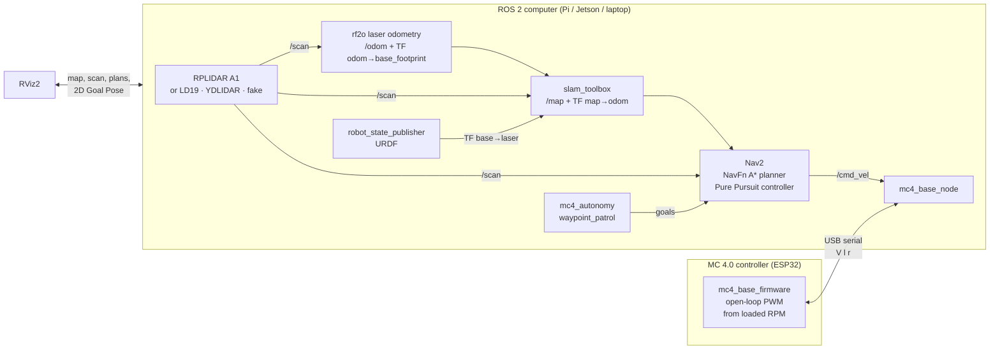

# mc4_ros2: MC 4.0 on ROS 2 with lidar SLAM, RViz and autonomous navigation

Turns the **MC 4.0** educational robotics kit into a ROS 2 robot that can
**map a room with a 2D lidar (SLAM)**, **show everything live in RViz**, and
**plan and drive paths autonomously (Nav2)**.

Target: **ROS 2 Jazzy on Ubuntu 24.04** (Raspberry Pi 4/5, Jetson or laptop).
Notes for Humble are at the end.

The current MC 4.0 build is a **4WD skid-steer chassis with no wheel
encoders**, an **ESP32** and an **RPLIDAR A1**. Because the wheels can't
report how far they turned, the lidar does the job: **rf2o laser odometry**
estimates motion from consecutive scans. Encoders are supported too, if you
add them later.



## Repository layout

| Path | What it is |
|------|------------|
| `src/mc4_description` | URDF/xacro of the MC 4.0 base + lidar; every dimension is a launch arg |
| `src/mc4_base` | Python driver: `/cmd_vel` → wheel speeds over serial; wheel odometry from encoders or dead reckoning. Also **fake hardware** and a **fake lidar** |
| `src/mc4_bringup` | Launch files + configs for lidar, SLAM Toolbox, Nav2 and RViz |
| `src/mc4_autonomy` | `waypoint_patrol`: autonomous multi-goal missions with Nav2 |
| `firmware/mc4_base_firmware` | Arduino/ESP32 sketch for the MC 4.0 controller board |
| `docs/ESP32_RPLIDAR_A1.md` | Wiring, flashing and first-run checks for the ESP32 + RPLIDAR A1 build |
| `docs/PROTOCOL.md` | Serial protocol + calibration guide |
| `docker/Dockerfile` | Full stack in a container (good for Windows + WSL2) |
| `scripts/99-mc4.rules` | udev rules → `/dev/mc4_base`, `/dev/mc4_lidar` |
| `scripts/calibrate_motors.py` | Measures loaded RPM and motor dead-band without encoders |
| `deps.repos` | Source-only dependencies: **rf2o laser odometry (required)**, LD19, YDLIDAR |

## 1. Install

```bash
sudo apt install python3-vcstool python3-colcon-common-extensions
mkdir -p ~/mc4_ws && cd ~/mc4_ws
git clone <this-repo-url> src/mc4_ros2
vcs import src < src/mc4_ros2/deps.repos      # rf2o lidar odometry (+ optional lidars)
rosdep install --from-paths src --ignore-src -y
colcon build --symlink-install
source install/setup.bash
```

## 2. Try it with no hardware (5 minutes)

```bash
ros2 launch mc4_bringup sim.launch.py
```

This starts a fake MC 4.0, a fake 360° lidar in a 6 × 4 m virtual arena,
SLAM, Nav2 and RViz. In RViz, click **2D Goal Pose** and drag an arrow. The
robot plans a path (green), follows it (yellow) and maps the arena as it goes.

Autonomous patrol in the same sim (second terminal):

```bash
ros2 run mc4_autonomy waypoint_patrol --ros-args \
  --params-file $(ros2 pkg prefix mc4_autonomy)/share/mc4_autonomy/config/waypoints.yaml
```

## 3. Real robot

> **Reference build: ESP32 DevKit + RPLIDAR A1.** For wiring, flashing and the
> first-run checks, follow [docs/ESP32_RPLIDAR_A1.md](docs/ESP32_RPLIDAR_A1.md).

### 3.1 Hardware assumptions (edit to match your kit)

| Item | Default | Where to change |
|------|---------|-----------------|
| Drive | 4WD skid steer, 2 motors per side in parallel | `four_wheel:=` launch arg |
| Controller | ESP32 DevKit (motors 25/26/27 + 14/16/17) | pin map in `firmware/.../mc4_base_firmware.ino` |
| Motor driver | L298N (or TB6612 for small motors) | firmware `setMotor()` |
| Wheel diameter / radius | 65 mm / 0.0325 m | `wheel_radius:=` launch arg |
| Track width | 250 mm (tune for skid steer) | `wheel_separation:=` launch arg |
| Wheelbase | 300 mm | `wheelbase:=` launch arg |
| Encoders | none: open-loop drive + lidar odometry | firmware `HAS_ENCODERS`, `use_encoders:=`, `odom_source:=` |
| Loaded motor RPM | **measure** with `scripts/calibrate_motors.py` | firmware `LOADED_RPM` |
| Lidar | RPLIDAR A1 at 0.18 m (example; measure) | `lidar:=`, `lidar_z:=`, `lidar_yaw:=` |
| ROS computer | Raspberry Pi 4/5 with Ubuntu 24.04 | n/a |

### 3.2 Flash, check and calibrate the firmware

1. Open `firmware/mc4_base_firmware/mc4_base_firmware.ino` in Arduino IDE, set the `INVERT_*` flags, and upload.
2. Measure the loaded RPM and motor dead-band with `scripts/calibrate_motors.py`, put them in the sketch, and upload again.
3. Full steps: [docs/ESP32_RPLIDAR_A1.md](docs/ESP32_RPLIDAR_A1.md) §2-3.

### 3.3 Stable USB names (recommended)

```bash
sudo cp src/mc4_ros2/scripts/99-mc4.rules /etc/udev/rules.d/
sudo udevadm control --reload && sudo udevadm trigger
```

### 3.4 Run

```bash
# On the robot
ros2 launch mc4_bringup robot.launch.py \
    base_port:=/dev/mc4_base lidar_port:=/dev/mc4_lidar lidar_z:=0.18
# Defaults: rplidar_a1, no encoders, odom_source:=lidar (rf2o), 4WD dimensions.
# Encoder build later: use_encoders:=true odom_source:=wheel

# Drive it by keyboard to check odometry
ros2 run teleop_twist_keyboard teleop_twist_keyboard
```

Supported `lidar:=` values: `rplidar_a1`, `rplidar_c1`, `ldlidar_ld19`,
`ydlidar_x4`, `fake`, `none`. Every driver publishes `/scan` in
`laser_frame`, so nothing downstream changes when you swap lidars.

## 4. SLAM: build a map

```bash
ros2 launch mc4_bringup slam.launch.py           # on robot
ros2 launch mc4_bringup rviz.launch.py           # on laptop
ros2 run teleop_twist_keyboard teleop_twist_keyboard
# drive slowly around the room, then:
ros2 run nav2_map_server map_saver_cli -f ~/maps/arena
```

## 5. Autonomous navigation and path planning

```bash
# Option A: navigate while mapping (no saved map)
ros2 launch mc4_bringup navigation.launch.py slam:=true

# Option B: navigate in a saved map with AMCL localisation
ros2 launch mc4_bringup navigation.launch.py map:=$HOME/maps/arena.yaml
```

In RViz: use **2D Pose Estimate** (option B only) to tell AMCL where the robot
is, then **2D Goal Pose**. Or run `waypoint_patrol` with `use_slam:=false`
for option B.

**What runs inside Nav2** (`config/nav2.yaml`):

* **Global planner:** NavFn with A* on the global costmap (static map + live lidar obstacles).
* **Local controller:** Regulated Pure Pursuit at 0.15 m/s with turning capped at 0.6-0.8 rad/s (kind to lidar odometry and skid steer); slows down near obstacles and in tight turns.
* **Recoveries:** spin, back up, wait.
* **Velocity smoother:** limits acceleration to suit small gear motors.
* The costmap `footprint` is a 0.39 × 0.30 m rectangle sized for the 300 mm wheelbase and 250 mm track, with `inflation_radius` 0.40 m. Re-measure if your chassis overhangs the wheels.

## 6. Multi-machine setup (robot + laptop RViz)

Both machines on the same Wi-Fi network:

```bash
export ROS_DOMAIN_ID=42        # same number on both, different per robot in a classroom
```

## 7. Windows users

Use **WSL2 (Ubuntu 24.04)**; RViz works through WSLg. For real hardware,
forward the USB devices into WSL with [usbipd-win](https://github.com/dorssel/usbipd-win)
(`usbipd attach --wsl --busid <id>`). For the sim, the Docker image works too:

```bash
docker build -t mc4_ros2 -f docker/Dockerfile .
```

## Humble (Ubuntu 22.04) notes

The packages build unchanged. In `nav2.yaml` the controller already lists
both `progress_checker_plugin` (Humble) and `progress_checker_plugins`
(Jazzy). Humble's `bt_navigator` ignores the `navigators:` block and uses
its built-in defaults. For ROS 2 Kilted or newer, Nav2 sends `TwistStamped` on
`/cmd_vel` by default: set `enable_stamped_cmd_vel: false` for the Nav2 nodes,
or switch `mc4_base_node` to `TwistStamped`.

## Roadmap ideas

* **Wheel encoders** (biggest upgrade): closed-loop speed and real wheel odometry. Firmware and driver already support them (`HAS_ENCODERS 1`, `use_encoders:=true`)
* An IMU (e.g. MPU6050) fused with rf2o in `robot_localization`, so turns stay accurate when scans smear
* `explore_lite` frontier exploration for fully autonomous mapping
* micro-ROS firmware on ESP32 (same topics, no serial bridge)
* Gazebo model for physics simulation
